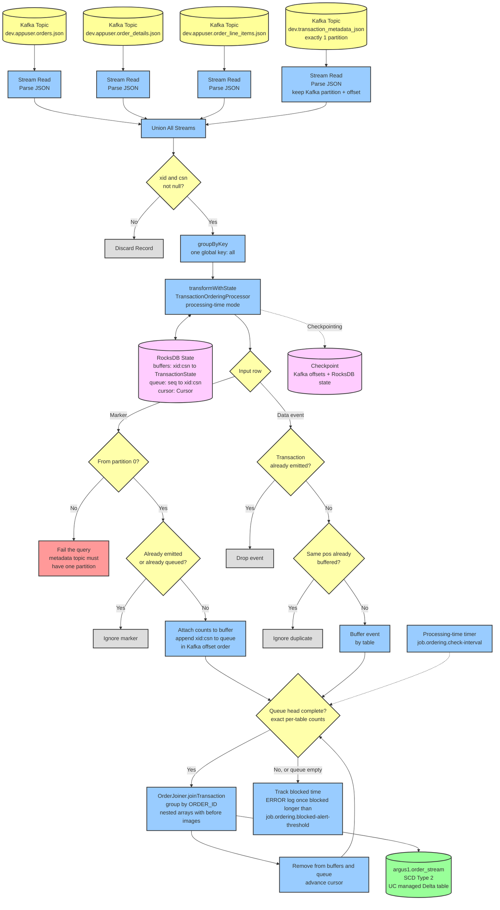
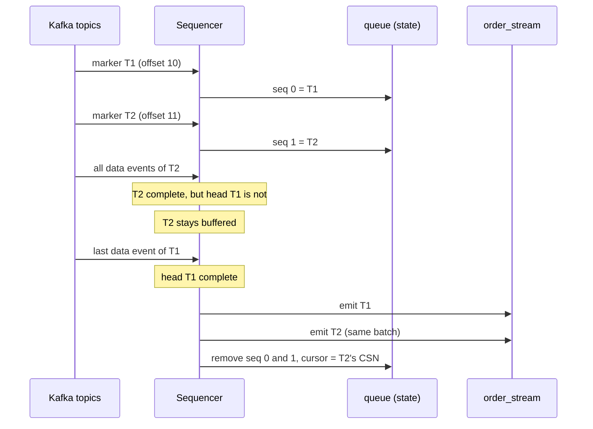
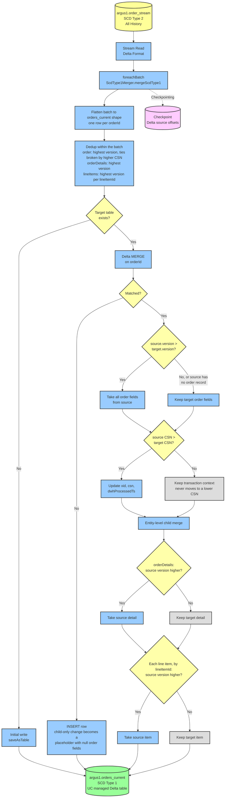
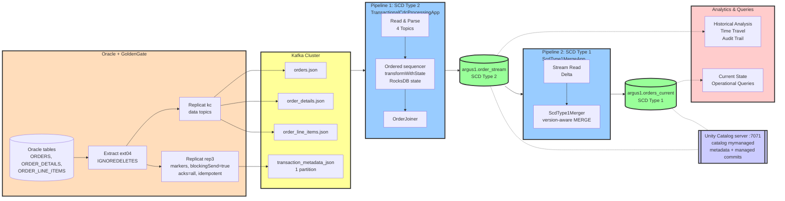
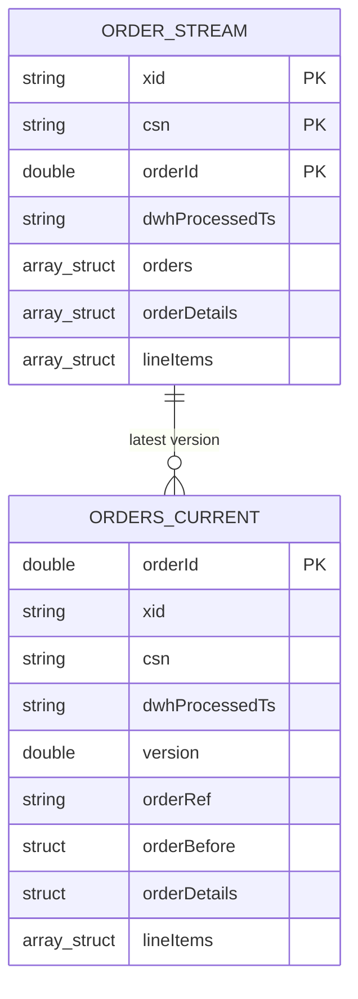
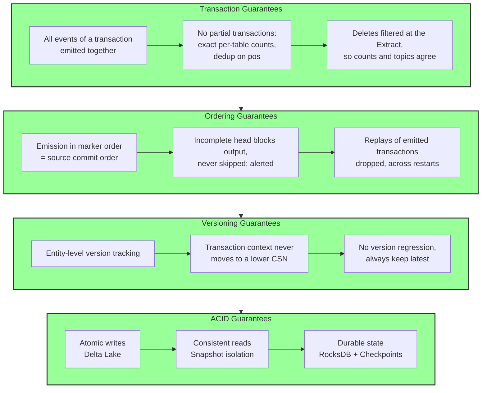

# Pipeline Architecture Diagrams

Mermaid diagrams of both CDC processing pipelines. Tables are Unity Catalog managed Delta tables
in `mymanaged.argus1`, running on Spark 4.1.1 and Delta 4.2.0 (see [UNITY_CATALOG.md](UNITY_CATALOG.md)).

## Pipeline 1: SCD Type 2, Ordered Transaction Assembly

`TransactionalCdcProcessingApp` reads CDC events from Kafka and assembles each source transaction
in a single `transformWithState` sequencer. It writes complete transactions to the SCD Type 2 table
`argus1.order_stream`, strictly in source commit order.

### Key Components

| Component | Description |
|-----------|-------------|
| **Kafka Topics** | 3 data topics plus the transaction metadata (marker) topic. The metadata topic must have exactly one partition |
| **Stream Processing** | Parse JSON. Markers keep their Kafka partition and offset |
| **Union + Filter** | Combine all 4 streams; drop rows without `xid`/`csn` |
| **Global key** | All rows share the key `all`, so one sequencer sees every in-flight transaction. It runs as a single task |
| **TransactionOrderingProcessor** | Spark `StatefulProcessor` adapter over `TransactionSequencer`, which holds the logic and is unit-tested without Spark |
| **`buffers`** | `MapState`: `xid:csn` → `TransactionState` (events by table, deduplicated on `pos`, expected counts from the marker) |
| **`queue`** | `MapState`: sequence number → `xid:csn`, in marker (Kafka offset) order, which is commit order |
| **`cursor`** | `ValueState[Cursor]`: next sequence numbers, last emitted CSN and the xids emitted at it, blocked-since time, timer |
| **Emission walk** | After each batch and on each timer, emit from the head of the queue while the head is complete. An incomplete head blocks everything behind it and is never skipped |
| **Replay detection** | Events and markers whose CSN is below the last emitted CSN, or equal to it with an already-emitted xid, are dropped |
| **OrderJoiner** | Denormalize a complete transaction into `OrderStream` records |
| **Trigger** | `Trigger.ProcessingTime(job.ordering.trigger-interval)`. In processing-time mode `transformWithState` would otherwise run empty batches back to back |
| **Output** | `argus1.order_stream`, a UC managed Delta table. Commits go through the Unity Catalog server |

### Out-of-Order Completion

Transactions are emitted in marker order, not in the order they complete:

To inspect `buffers`, `queue` and `cursor` from a checkpoint, see
[STATE-STORE-DEBUG.md](STATE-STORE-DEBUG.md).

---

## Pipeline 2: SCD Type 1, Current State Maintenance

`ScdType1MergeApp` streams `argus1.order_stream` and runs `ScdType1Merger` in `foreachBatch`. The
merger keeps one row per order in `argus1.orders_current`, versioning each entity independently.

### Key Components

| Component | Description |
|-----------|-------------|
| **Source** | `argus1.order_stream`, read as a Delta stream |
| **ScdType1Merger** | Extracted from `ScdType1MergeApp`; transforms each batch and runs the MERGE. Tested in `ScdType1MergerTest` |
| **Intra-batch dedup** | One row per `orderId`. Order: highest `version`, ties broken by higher CSN (numeric). Children deduplicated by their own version |
| **Delta MERGE** | Matches on `orderId`. Two `whenMatched` clauses: source order version wins, or keep the target's order fields |
| **Transaction context guard** | `xid`, `csn`, `dwhProcessedTs` update only when the source CSN is numerically higher, so a replay never moves them backwards |
| **Placeholders** | An order first seen through a child-only change is inserted with null order fields and filled in when its order record arrives |
| **Entity-level merge** | Order, order details and each line item are versioned independently |
| **Output** | `argus1.orders_current`, a UC managed Delta table |

---

## Complete End-to-End Flow

Deletes are filtered at the Extract, so the data topics and the marker counts always agree. The
apps resolve `argus1.*` against the default catalog `mymanaged`. Every commit to a managed table goes
through the Unity Catalog server, so the server must be running while the apps write.

---

## Data Model Comparison

### Schema Differences

| Aspect | SCD Type 2 (`order_stream`) | SCD Type 1 (`orders_current`) |
|--------|---------------------------|-------------------------------|
| **Primary Key** | (xid, csn, orderId), composite | orderId |
| **Row order** | Commits in source commit order | n/a, one row per order |
| **Order Structure** | Nested `orders ARRAY<STRUCT>` | Flattened top-level fields (null for a placeholder) |
| **Order Details** | `ARRAY<STRUCT>` with before | Single `STRUCT` with before (1:1) |
| **Line Items** | `ARRAY<STRUCT>` with before | `ARRAY<STRUCT>` with before (1:N) |
| **Records per Order** | One per transaction that touched it | One (current only) |
| **Inserts** | Always append | Upsert based on version |
| **Updates** | Never update, only append | Update in place if version is higher |
| **Transaction context** | The transaction that produced the row | Highest CSN seen for the order |
| **Before Images** | Inside each array element | `orderBefore` struct + inside details/items |
| **Use Case** | Historical analysis, audit | Current state queries |

---

## Processing Guarantees

### What These Guarantees Cost

- **Head-of-line blocking:** a transaction that never completes (lost event or marker) halts all
  output until someone intervenes. It's logged as an error, never skipped.
- **No scale-out:** the sequencer runs as a single task on one global key.
- **Unbounded orphan buffers:** data events whose marker never arrives stay buffered. They can't
  block output, but they consume state (no TTL).
- **Single-partition metadata topic:** markers must arrive in commit order on one partition.
